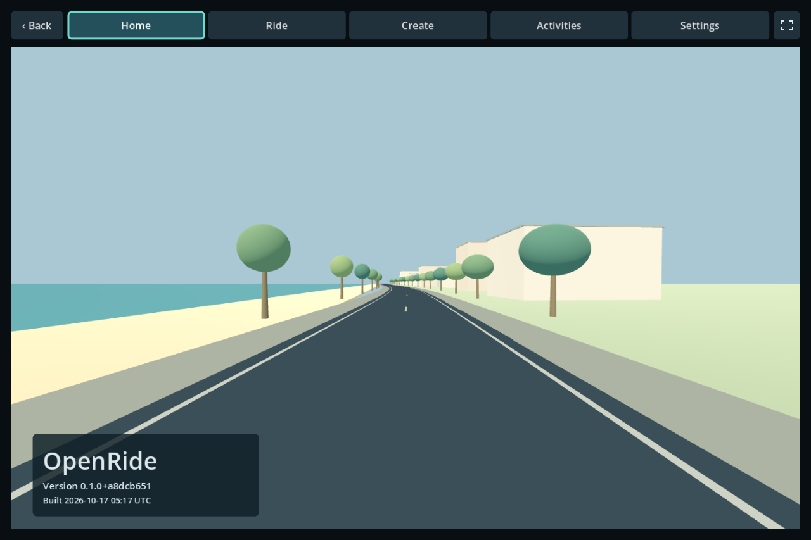
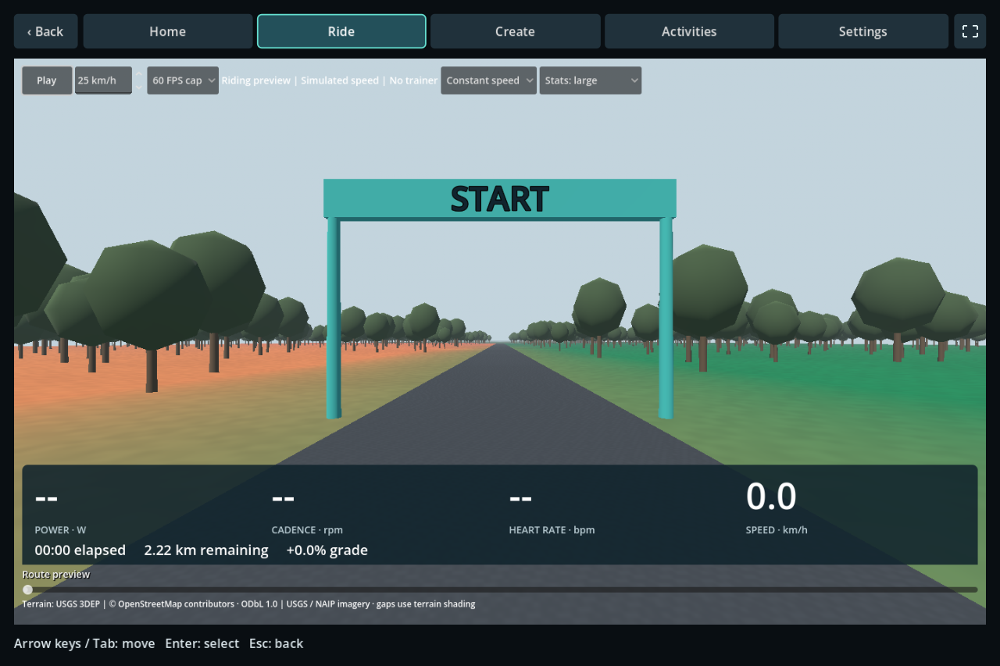

# OpenRide

An offline cycling simulator using real geographic routes and controllable indoor trainers.



The Windows prototype supports route authoring, streamed scenery, Suito Bluetooth rides,
activity history and FIT/TCX/GPX exports. Compatibility is limited to documented tested
configurations; see [M6 progress](docs/m6-progress.md) for pairing and virtual shifting.
Launch `dist/OpenRide.exe` from a local build, keeping its companion files together.
Mobile is deferred; original code is MIT licensed.

**Create** uses a four-stage Ride Project workflow: **Recording → Roads → Preview
→ Scenery & share**. Import a GPX/TCX road ride, infer its connected road sequence,
review uncertain roads and build a terrain-derived course. Maps, scenery edits and
ZIP sharing use the bundled Rust `openride-author.exe`; diagnostics are collapsed.
Original recordings and legacy projects remain preserved. See
[road-first authoring](docs/road-first-authoring.md) for steps and current limits,
and [Ride Projects and CLI](docs/ride-projects.md) for the compatibility commands.

## Route preview



These screens use fictional or synthetic scenery. The route preview shows simulated
speed with no trainer connected. See the [illustrated road review workflow](docs/road-first-authoring.md#desktop-workflow)
for the Create screen.

## First-time setup (Windows x64)

These instructions are for contributors building from source. Install:

- Git and PowerShell (Windows PowerShell 5.1 is supported).
- Rust through rustup, using the `x86_64-pc-windows-msvc` toolchain. Install the
  Visual Studio C++ Build Tools with the **Desktop development with C++** workload
  and Windows SDK for the native compiler/linker. The current build is tested with
  Rust 1.93.1.
- **Godot 4.6.2**, the standard Windows x64 edition. The .NET edition is not required.
  Matching export templates are needed only when exporting the desktop app.
- A standalone **Python 3.11+** for legacy authoring tools and compatibility tests (tested with 3.14.6).
  The standard tooling uses Python's standard library; no pip installation is needed.
  Git Bash is optional and is not required for the Windows build.

Clone the repository and open PowerShell in its root directory, containing
`Cargo.toml`. All commands below run from that directory.

Create your local tool configuration once, preserving any existing configuration:

```powershell
if (-not (Test-Path build/environment.local.psd1)) {
    Copy-Item build/environment.example.psd1 build/environment.local.psd1
}
notepad build/environment.local.psd1
```

Set `Python` and `Godot` to your executable paths if PATH discovery does not find
the desired installations. `PowerShell` and `Bash` overrides are optional. Empty
values use PATH discovery. Use standalone Python rather than a WindowsApps launcher
or an interpreter bundled with another application. The local configuration is
Git-ignored; the example is shared. See [tool environment setup](build/README.md).

At the start of each development PowerShell session:

```powershell
. ./build/Use-Environment.ps1
rustc --version
cargo --version
python --version
godot --version

# Keep development/build Godot settings separate from your normal rider settings.
$env:APPDATA = Join-Path (Get-Location) 'local/godot-appdata'
New-Item -ItemType Directory -Force $env:APPDATA | Out-Null
```

This configures only the current shell and its child processes. If PowerShell
blocks local scripts, a session-only option is
`Set-ExecutionPolicy -Scope Process -ExecutionPolicy Bypass`; then rerun the setup.

Fetch the locked Rust dependencies once while online:

```powershell
cargo fetch --locked
```

After this, the build/test commands below can use the Cargo cache offline.
No trainer, personal recording, map download or credentials are needed to compile
the application or run the default tests.

## Build and run during development

Close any running OpenRide instance before rebuilding so its native DLL can be
replaced. Build before opening a fresh Godot checkout:

```powershell
./tools/build.ps1 -Offline
godot --path apps/rider
```

The build synchronizes the scenery runtime and builds `openride-godot`,
`device-probe`, `content-builder`, and `openride-author` with locked dependencies.
It copies the DLL and executables into `apps/rider/bin`, and imports
Godot assets. To open the editor instead, run `godot --editor --path apps/rider`
after building. Edit scenery/editor sources in `apps/scenery-preview`; the copies
under `apps/rider` are generated by the build.

## Build the Windows desktop package

Install the standard **4.6.2** export templates into the Godot settings directory
used by this shell. With the isolated APPDATA above, the Windows x64 template files
from the matching export-template archive belong directly in:

```text
local/godot-appdata/Godot/export_templates/4.6.2.stable/
```

Include `windows_debug_x86_64.exe`, `windows_debug_x86_64_console.exe`,
`windows_release_x86_64.exe` and `windows_release_x86_64_console.exe`.
Templates installed under your normal APPDATA are separate from this development
directory. Then build and export:

```powershell
./tools/export-rider.ps1 -Offline
./dist/OpenRide.exe
```

Keep the entire `dist` directory together, including the PCK, native DLL,
device worker and `authoring/openride-author.exe` plus `authoring/content-builder.exe`.
The export script runs the release build first, so it includes current Rust route
tools as well as the UI. New Ride Projects use Rust for import, road inference,
repairs, map acquisition, scenery, preview assembly and ZIP sharing; Python is
needed only for legacy workflows and compatibility tests.
Build import logs are under `local/build-godot.*.log`; export logs are
`local/export-rider.log` and `local/export-rider.err`.

The scripts honor the configured Godot path. An explicit `-Godot` argument
overrides it. For a single Python command in a fresh shell, use
`./build/run.ps1 python path/to/script.py`.

## Run the default checks

After loading the tool environment and fetching dependencies:

```powershell
cargo test --workspace --locked --offline
python -m unittest discover -s tools/tests
```

Private-data and physical-hardware tests are ignored by default; do not enable
them wholesale. Automated Godot checks must use isolated APPDATA as above and
hidden, bounded processes with redirected logs. See the [development guide](docs/development.md)
for integration checks and the [tool inventory](tools/README.md) for other commands.

## Project documentation

- [High-level project plan](docs/project-plan.md): product scope, recommended architecture, content workflow, and open decisions.
- [Milestone roadmap](docs/milestones.md): proposed delivery sequence and acceptance criteria.
- [Development guide](docs/development.md): importer, preview, native build, and verification commands.
- [M1 progress](docs/m1-progress.md): implemented work, evidence, and remaining gates.
- [M2 progress](docs/m2-progress.md): session policy, simulated recording, and remaining hardware work.
- [Activity exports](docs/activity-exports.md): local FIT/CSV exports, pause handling, recovery, and validation limits.
- [M3 progress](docs/m3-progress.md): standalone scenery preparation, RPV source findings, preview tools, and the next terrain/data steps.

See [tool inventory](tools/README.md) for build/test commands and the distinction
between production authoring tools, synthetic tests and local artifacts. See
[tooling direction](docs/tooling-roadmap.md) for the proposed Rust authoring migration
and agent workflows. Personal Garmin samples, downloaded maps, captures and generated
route packages are excluded from the repository; a fresh checkout does not include them.
