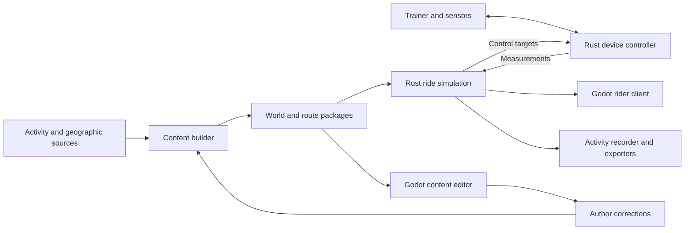

# OpenRide project plan

Status: proposed architecture, informed by project discussion and research through October 5, 2026.

Audience: the project owner and future contributors. Use this document to choose milestone scope and evaluate implementation decisions against the intended product. The [milestone roadmap](milestones.md) defines the proposed delivery gates.

## 1. Product goal

Build an open-source-friendly cycling application that runs locally, displays believable scenery derived from geographic data, and adjusts a smart trainer as the rider follows a route. Riders own their routes and activity records. Installed content and ordinary riding must work without an account or internet connection.

The initial experience is automatic route following: pair equipment, select a prepared route, ride, and save/export the activity. Intersections follow the selected route without rider input. Recognizable geography, smooth roads, coherent gradients, and reliable trainer behavior take priority over photorealism.

Downloading source maps can require connectivity during preparation. A prepared content package must include everything needed for offline riding. Local network communication can be added without introducing a cloud dependency.

## 2. Scope and delivery recommendations

Initial release scope:

- One rider following a selected real-world route.
- Elite Suito control and telemetry over Bluetooth LE, followed by ANT+ support for the available equipment.
- Heart-rate input from a Garmin Fenix 6 Pro and cadence input from the Garmin sensor where supported.
- Local activity/route import and independent installation of prepared scenery.
- Durable activity recording, export, live metrics, and a concise ride summary.
- A separately usable content preparation tool with visual inspection and correction.

Confirmed: Windows desktop is the first supported platform; mobile is deferred. Structure the code for other platforms without making mobile packaging or feasibility a gate for the initial milestones. A phone companion and a phone running the entire simulator remain separate future milestones.

### Desktop performance baseline

The owner selected 16 GB system RAM and 8 GB dedicated VRAM as the initial hardware capacity baseline, informed by the [Steam Hardware & Software Survey](https://store.steampowered.com/hwsurvey/En). The September 2026 survey, accessed October 5, reports Windows 11 64-bit, 32 GB RAM, eight physical CPU cores, and 1920 x 1080 as the most popular respective categories. These are separate category modes, not a measured average computer or a single representative configuration.

Use the following working profile:

| Component | Planning target | Status |
|---|---|---|
| Platform | Windows desktop | Confirmed |
| System memory | 16 GB installed | Confirmed baseline |
| Graphics memory | 8 GB dedicated VRAM | Confirmed baseline |
| OS/version | Windows 11, x86-64 | Recommended reference configuration; exact supported versions to settle |
| CPU | Mainstream eight-core desktop class | Provisional survey-informed reference; select a named benchmark CPU |
| GPU | Select a named mainstream GPU with 8 GB VRAM | Throughput target remains open; memory capacity alone is insufficient |
| Display | 1920 x 1080, targeting 60 FPS | Proposed rendering target |
| Storage | Local SSD for installed content | Recommended test configuration |

These are development targets, not verified minimum requirements. Leave capacity for Windows, drivers, and other applications: provisionally budget at most 8 GB application private committed memory and 6 GB dedicated GPU memory during a representative ride, including loading peaks. Validate these budgets with measured working set, system memory pressure, and GPU allocation/residency before making support claims. Authoring/build tools may have separately documented resource requirements.

M3 should measure frame-time percentiles and streaming stalls at 1080p, alongside memory and package size. Record exact CPU/GPU models and driver versions; do not substitute GPU memory capacity or CPU clock speed for performance measurements. Freeze the reference machine and detailed frame-time acceptance thresholds before that gate.

Defer free exploration, steering, competitive multiplayer, broad legacy trainer coverage, cloud accounts, detailed training analytics, and photorealistic city reconstruction. Structured ERG workouts follow the first reliable terrain-controlled ride.

## 3. Recommended architecture

Use Godot for the visual client and authoring UI, with Rust libraries for simulation, devices, activity data, and content processing. Keep the Rust core independent of Godot types. Use Incyclist, GoldenCheetah, QZ, and FortiusANT as references; evaluate individual dependency licenses before reuse. No JavaScript runtime is proposed for the riding application.

Godot is the leading candidate because visual inspection and content iteration are central to this project. Confirm the choice with a representative scene and native integration feasibility check. Bevy remains the fallback if Godot integration, performance, or packaging fails a concrete requirement. Small executable size alone should not determine the engine.

These are logical boundaries. Initially expose the libraries through a thin Rust GDExtension inside Godot. A later executable can host the same controller libraries for a device bridge, and a headless simulation can support multiplayer. Do not implement distributed services solely to anticipate that future.

Device I/O and recording must not depend on frame rendering. Exchange commands, events, and state snapshots through bounded queues; access the active Godot scene through its main thread. The adapter owns conversions between engine and core types.

Deferred mobile feasibility includes native library builds, Bluetooth permissions, application suspension, USB availability, and the Godot Rust binding's platform maturity. A working desktop extension does not establish mobile support.

## 4. Ride simulation and hardware

The simulation owns virtual progress and speed using measured power, rider/bike mass, road gradient, aerodynamic resistance, and rolling resistance. Trainer-reported speed remains a measurement with a distinct meaning. Route progress must not depend on visual mesh detail or frame rate.

Use an authoritative road profile shared by visual road placement and simulation. Apply trainer-specific limits and response smoothing when forming device commands. Record both course grade and commanded grade when they differ. A trainer-difficulty setting must not silently change the course or virtual physics.

Support explicit control modes:

- Simulation: terrain and environmental parameters determine trainer requests.
- ERG: a workout determines target power. Terrain cannot simultaneously own resistance.

The controller discovers capabilities, negotiates control, serializes commands where required, handles acknowledgments and timeouts, and maintains one active control owner. Include bounded changes, pause/resume behavior, stale telemetry handling, reconnect policy, and logs that explain failures. Measure the Suito's behavior on interruption; never assume a disconnect resets its resistance.

Hardware sequence:

Planning update (2026-10-11): [M6 multi-device pairing and friend testing](m6-device-compatibility.md)
defines the next compatibility expansion, including CORE/Cog virtual shifting,
M2 validation and an Echelon feasibility check. The initial sequence below remains
historical context; M6 records current priorities and verification boundaries.

1. Suito BLE FTMS telemetry and simulation control.
2. Fenix heart-rate broadcast and cadence-source selection.
3. USB ANT adapter support for sensor profiles and FE-C control.
4. Named USB/serial trainer implementations when equipment and test coverage exist.

Confirm firmware, sensor model numbers, and adapter availability. The wheel-speed sensor has no useful rotating wheel on the Suito direct-drive setup; preserve future support for other trainer configurations. Only one transport should control the same trainer at a time.

## 5. Activities, routes, and athlete data

Keep these distinct:

| Object | Meaning |
|---|---|
| Activity | Timestamped measurements, pauses, laps, and recorded or simulated positions from a session |
| Route | Ordered path, distance, corrected elevation, and optional instructions |
| World | Terrain, roads, structures, vegetation, and assets shared by routes |

An activity can produce a route without altering the original activity. Support trimming, gap review, uncertain road matching, intentional loops, and duplicate import detection. Preserve provenance for imported and corrected elevation. A long time gap alone does not prove a road discontinuity or an athlete pause.

Use manual imports initially. The owner reports that Garmin is not currently accepting developer applications; account synchronization is not a prerequisite. Prefer original FIT files when available, while supporting the supplied TCX and GPX exports. Decode relevant GPX extensions rather than treating GPX as coordinates only.

Record sessions incrementally in a recoverable local representation. Preserve timestamps, sensor identity, missingness versus zero, elapsed time, timer time, and measured versus simulated values. Define moving time explicitly if displayed. Recover a partial session after a crash and generate exports from the durable record.

Export targets:

- FIT for detailed activity interchange.
- TCX as an additional activity format.
- GPX for route/track interchange.
- CSV for time-series inspection.

Validate generated files in independent tools, including GoldenCheetah. Audit FIT library licensing and supported encoding behavior before adopting an implementation. Virtual geographic coordinates must be an explicit export choice; identify virtual riding where the target format permits.

Built-in analysis remains focused: live power, cadence, heart rate, time, distance, elevation/progress, recent graphs, laps, and post-ride summaries. Long-term analytics stay with the athlete's preferred tools.

### Available sample evidence

The October 5 inspection parsed all 31 supplied XML files: 16 TCX activities and 15 paired GPX exports spanning 2009–2026. No FIT sample or power field was found in this sample inspection. TCX retains additional lap, distance, speed, and non-position samples. Some files contain long timestamp gaps, partial sensor coverage, or repeated/non-increasing timestamps that require further classification.

Proposed reference activities, using recorded TCX lap distances:

| Activity | Distance | Use |
|---|---:|---|
| 2022 RPV | 12.54 km | First route; timestamp gaps no greater than 15 seconds in the initial inspection |
| 2026 Torrance Beach | 23.92 km | Recent export, multiple laps, missing-position samples |
| 2012 Death Ride | 171.08 km | Long route and streaming evaluation |
| 2012 work_to_laps | 89.04 km | Cleanup, partial sensors, and roughly 16-hour recorded span |

These distances and point counts are source observations, not route-quality validation. Exact locations and original biometric records remain local unless the owner chooses to share them. Public fixtures should be synthetic or explicitly approved and stripped of unnecessary personal data.

## 6. Geographic content pipeline

Use OpenStreetMap for road topology and land features. Start with USGS 3DEP elevation for the Southern California reference route after checking local coverage and resolution. Evaluate Copernicus DEM as a broader fallback, recognizing that it represents surface heights including vegetation and structures.

Evaluate OSM2World before implementing all scene generation. Use GDAL and QGIS for geographic conversion and inspection; use Blender/BlenderGIS for asset work and scene diagnosis. OpenCityModel and Overture can enrich buildings where useful. 3DCityDB is optional infrastructure for large city-model workflows and is not required by the rider application.

Build a hybrid content pipeline:

1. Preserve source activity and geographic data with source versions.
2. Extract and optionally match the route to roads, exposing uncertainty.
3. Normalize coordinate systems and vertical references.
4. Correct road profiles, bridges, tunnels, and problematic intersections.
5. Prepare spatial tiles, nearby detailed scenery, and simpler distant terrain.
6. Bake complex or custom geometry; retain semantic data for simple generation and asset placement.
7. Validate coverage and dependencies, then publish an independent package.

Do heavy GIS work before riding. Stream prepared content near the rider. Preserve geographic coordinates with sufficient precision and render in local coordinates using an origin strategy. Total route length must not require loading the entire route at full detail.

Store reusable authored assets in Blender source form and distribute runtime geometry using an agreed glTF/GLB subset. Do not ship Blender as a rider prerequisite. Benchmark chunk sizes, detail levels, and load behavior before freezing numeric limits.

## 7. Authoring and corrections

Provide a standalone content builder with a command-line interface, plus a visual authoring tool sharing the rider's loader and renderer. The authoring environment may require larger GIS dependencies than the rider application.

Store corrections separately from generated output: road alignment, elevation controls, bridge/tunnel treatment, building adjustments, excluded objects, and landmark placement. Reference stable source identifiers where possible. Regeneration must preserve applicable corrections and report conflicts when sources change.

The first editor should support route/profile inspection and a small set of useful corrections. A general city editor is outside the initial scope. Route editing, geographic corrections, and mesh editing are separate operations even if exposed in one tool.

## 8. Independent packages and sharing

Installed apps must discover and load new world/route content without rebuilding the application. Recommend a documented, data-only package format containing standard assets and application metadata. Godot can load GLB at runtime; engine-specific packs may remain an optional trusted distribution optimization.

Each package needs identity, schema/content versions, compatible reader capabilities, bounds, source attribution/licenses, checksums, and explicit dependencies. Separate world packages, lightweight routes, and shared asset collections. Offer a self-contained bundle for convenient offline sharing. A route may span multiple prepared areas; dependency manifests must describe complete coverage.

Provide a user-selected content library with drop-in installation, startup/refresh discovery, and an import action for mobile storage. Validate before indexing. Show missing dependencies, incompatible versions, and incomplete coverage as actionable errors. Pin world/route versions for active sessions and activity history; updates must not silently rewrite prior distances or elevation profiles.

Packages contain data, not executable plugins. Bound archive sizes and extraction paths, validate referenced assets, and publish/install atomically so incomplete copies do not become selectable routes. Engine caches are disposable and separate from source packages.

A future community catalog can be a static index of package metadata, download locations, hashes, and licenses. Local package use must remain independent of the catalog. Keep large source datasets and published scenery outside the application source repository.

## 9. Source organization and open-source approach

Begin with a monorepo containing the Godot rider, Godot authoring application, independent Rust libraries, content builder, package schemas, documentation, and small fixtures. Group Rust responsibilities around ride simulation, devices, activity interchange, content formats, and the Godot adapter. Introduce additional crates when boundaries justify them.

Confirmed: original application and library code uses the MIT license. Track dependency, asset, and geographic-data licenses separately. OSM-derived databases and scenery require a considered attribution/distribution workflow; do not assume the application license covers content.

Keep personal imports out of any future public repository. No source-control initialization, publishing, software dependencies, or hardware control is authorized by this planning document alone.

## 10. Open decisions

Before implementation of the first milestone, settle:

- Exact Windows version and reference CPU/GPU models within the confirmed 16 GB RAM / 8 GB VRAM baseline. Mobile is deferred.
- Dependency-specific licensing compatibility with the confirmed MIT direction.
- Availability of Suito, watch, cadence sensor, and an ANT USB adapter for supervised tests.

Resolve through milestone evidence:

- Rust/Godot extension and BLE library compatibility on the chosen platform.
- ANT transport/profile implementation and current distribution terms.
- RPV source coverage, trustworthy elevation, and required corrections.
- Package schema, chunk sizes, and acceptable installation/load budgets.
- FIT encoder choice and interoperable export behavior.

## Research references

These links supported the planning discussion. Recheck platform support, versions, and terms before adopting dependencies.

- [Godot Rust bindings](https://github.com/godot-rust/gdext) and [btleplug](https://github.com/deviceplug/btleplug).
- [Godot runtime file loading](https://docs.godotengine.org/en/stable/tutorials/io/runtime_file_loading_and_saving.html) and [large world coordinates](https://docs.godotengine.org/en/stable/tutorials/physics/large_world_coordinates.html).
- [Incyclist devices](https://github.com/incyclist/devices), [GoldenCheetah](https://www.goldencheetah.org/), [QZ](https://github.com/cagnulein/qdomyos-zwift), and [FortiusANT](https://github.com/WouterJD/FortiusANT).
- [Garmin export instructions](https://support.garmin.com/en-US/?faq=W1TvTPW8JZ6LfJSfK512Q8) and [FIT SDK](https://developer.garmin.com/fit/get-the-sdk/).
- [OSM2World](https://github.com/tordanik/OSM2World), [GDAL](https://gdal.org/), [USGS 3DEP](https://www.usgs.gov/3d-elevation-program), and [Copernicus DEM](https://dataspace.copernicus.eu/explore-data/data-collections/copernicus-contributing-missions/collections-description/COP-DEM).
- [OpenCityModel](https://github.com/opencitymodel/opencitymodel), [Overture](https://overturemaps.org/), and [BlenderGIS](https://github.com/domlysz/BlenderGIS).
- [OSM licensing](https://www.openstreetmap.org/copyright), [tile service policy](https://operations.osmfoundation.org/policies/tiles/), and [ANT+ program changes](https://thisisant.developer.garmin.com/pages/business/go-ant/ant-brand/index.html).
