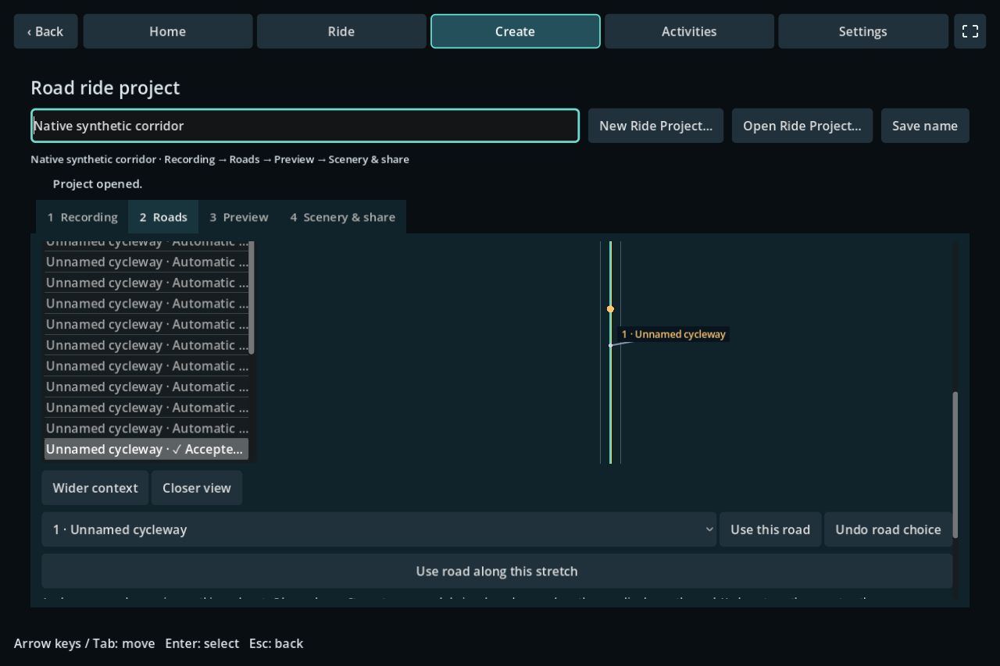

# Road-first authoring

Direction approved 2026-10-13: recreate a recorded **road ride** from its road
sequence. A recording supplies evidence about where the rider went; acquired road
geometry and terrain define the generated course. Original recordings, recorded
elevations, legacy repairs and previously built packages remain separate.

## Desktop workflow

1. **Recording:** create/open a Ride Project, import its GPX/TCX variants and choose
   **Use recording** for the reference. Source comparison, recorded elevation and
   import logs are under Recording details. Legacy repair tools are collapsed.
2. **Roads:** click **Download maps & infer roads** to plan coverage, resume road
   and topography downloads, then infer the course. Individual downloads remain
   available in coverage details; **Infer roads** reruns only inference.
   Review the uncertain stretches in the list beside the map. The dropdown names
   nearby roads; selecting one highlights it in amber. **Use this road** saves a
   choice for this particular visit. **Undo road choice** restores inference.
   **Use road along this stretch** also constrains nearby ambiguous occurrences
   along that road, up to 5 km in each direction. Connected, unbranched pieces with
   the same name/ref and road class may continue across OSM way boundaries; unnamed
   roads use their exact way identity. Gaps, turnarounds, existing choices, and
   leaving the road stop propagation. A saved group can be undone from any member;
   a later individual edit is preserved when the rest of the group is undone.
   **Inspect all road occurrences** also permits reviewing an automatic choice.
   For a short disconnected transition, **Connect using recording** previews and
   accepts the recorded path between the two snapped road endpoints. This explicit
   off-road exception is limited to 250 m of continuous GPS data. It remains marked
   **Recorded connection**, uses terrain elevations, and has its own undo. Accepted
   road choices are preserved; the legacy trace-correction tools do not edit the
   road-first course.
3. **Preview:** build and open the continuous 3D course. Heights are generated from
   terrain, so missing or conflicting recorded elevation does not block this path.
4. **Scenery & share:** acquire/edit optional scenery, return to Preview to rebuild,
   then export the ordinary ZIP. Imagery is optional in map coverage details.

Stage navigation stays visible while each stage scrolls independently. The old
trace-based course remains available for compatibility; **Infer roads** explicitly
creates the new course. Existing legacy edits are not silently translated into
road choices, and a stale road plan never silently falls back to a legacy course.



The Roads stage above uses a synthetic project. The list keeps accepted and automatic
occurrences available for inspection; the map highlights the selected candidate.

## Geometry, confidence and persistence

The native matcher spaces redundant observations by at least 15 m, keeping explicit
choices, breaks and the final observation. Candidate roads must be within 30 m.
Forward/backward sequence scoring uses connected graph paths and the complete
observation run, so later evidence can resolve an earlier parallel-road choice.
Matching respects explicit access/bicycle restrictions and one-way direction,
including implicit roundabout direction. Equal competing roads remain uncertain.
Different projections along the same road are not separate road choices.

Road scope includes ordinary streets and cycleways. Paths/footways require both
explicit bicycle permission and a paved surface; explicitly unpaved surfaces,
tracks, steps and motorways are excluded. This is a recreation policy, not a legal
routing service. Local defaults and OSM turn-restriction relations are not modeled.

OSM node identity defines connectivity: crossing coordinates alone are insufficient.
Each inferred section retains the identities of all traversed ways, not just its
last road. Repeated visits retain recording-occurrence identities. Recording gaps
remain review items even when a connected route can be proposed. Missing coverage,
disconnected roads and transitions beyond the bounded search are not auto-approved.

`roads.json` stores the versioned derived course, source/map identities and road
choices. `course.json`, `corrections.json`, `repairs.json` and the source snapshots
are left intact. Changing inputs makes the derived result stale; conflicting
choices require **Restart road inference (archive choices)** under Changed
recording or maps. Restart saves the previous road plan under `jobs/` before
publishing its replacement. Failed or cancelled inference retains the prior plan.
The CLI uses the same project lock, revision checks and JSON-lines protocol as the UI.

```powershell
./dist/authoring/openride-author.exe project infer-roads "local/My Ride" --expected-revision REVISION
./dist/authoring/openride-author.exe project choose-road "local/My Ride" --expected-revision REVISION --sample 120 --way OSM_WAY_ID
./dist/authoring/openride-author.exe project choose-road "local/My Ride" --expected-revision REVISION --sample 120 --way OSM_WAY_ID --scope nearby
./dist/authoring/openride-author.exe project choose-road "local/My Ride" --expected-revision REVISION --sample 120 --mode undo
./dist/authoring/openride-author.exe project choose-road "local/My Ride" --expected-revision REVISION --sample 120 --mode connect
./dist/authoring/openride-author.exe project choose-road "local/My Ride" --expected-revision REVISION --sample 120 --mode undo-connection
./dist/authoring/openride-author.exe project reset-roads "local/My Ride" --expected-revision REVISION
```

Read the returned revision before each mutation. `build-package` automatically uses
the current road-first course once `roads.json` exists.

## Generated elevations and remaining limits

Canonical `route.json` profiles have an 8 MiB budget, separate from the 2 MiB
budget for individual scenery JSON payloads. The builder checks route size before
generating scenery. The 10,000-point profile limit and existing chunk/mesh limits
still apply; increasing the byte budget does not simplify or alter route geometry.
Use matching current app and native tools when sharing these larger packages.

Course heights sample verified terrain at road geometry stations no more than
30 m apart and apply a local 30 m weighted smoothing window. Recorded elevations
are reference annotations only. Mesh generation independently subdivides roads to
at most 10 m. Existing terrain/route/chunk resource budgets still apply.

Tagged bridges/layered roads use a provisional profile between terrain-supported
ends; actual deck heights are not supplied by the DEM. A route beginning or ending
on such a structure requires more context. **Tunnel preview builds are explicitly
blocked** until interior geometry exists; sampling a hilltop as tunnel elevation
would be incorrect. Representative bridge validation remains open. Unresolved road
choices block building, and unusually steep generated grades require inspection.

Next work: resolve the real OC proposal's remaining ambiguities and missing
connection, improve handling of sparse recordings beyond the 500 m transition
limit, add turn restrictions and tunnel geometry, and validate bridges and terrain
profiles on real rides. A complete automatic solution for these exceptions is not
claimed by this refactor. Trainer/hardware acceptance remains separate.
